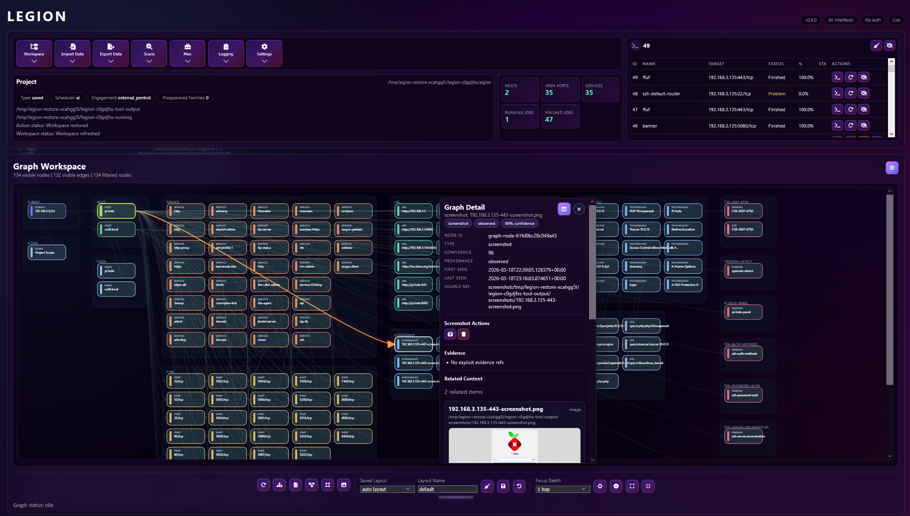

# LEGION

[](https://snyk.io/test/github/Hackman238/legion?targetFile=requirements.txt)
[](https://codeclimate.com/github/Hackman238/legion/maintainability)
[](LICENSE)

<p align="center">
  
</p>

Legion is a local-first, operator-guided reconnaissance and penetration testing platform. It imports or runs Nmap
scans into a persistent project, correlates everything it learns about each host in a local evidence graph, and runs
follow-up tooling through a governed scheduler: deterministic rules by default, with optional AI assistance from
OpenAI, Claude, LM Studio or any OpenAI-compatible local server. Risky actions pass through engagement policy, risk
classification and an explicit approval queue before anything runs, and every decision is audited in the project.

The same orchestration core is exposed through a **web UI** (the primary interface), a **headless CLI** for
automation, and an **MCP server** for AI agents. The former Qt desktop UI has been removed; `python legion.py` now
starts the web interface.

<p align="center">
  
</p>

## Quick start

```shell
git clone https://github.com/Hackman238/legion.git
cd legion
python3 -m venv .venv
source .venv/bin/activate
python -m pip install --upgrade pip -r requirements.txt
python legion.py --web
```

Then open <http://127.0.0.1:5000>. The web UI has no authentication when it listens on localhost only; when you
expose it with `--web-bind-all`, Legion requires a web token (generated and printed at startup, or set with
`--web-token` / `LEGION_WEB_TOKEN`). Scanning needs raw-socket access, so run Legion as root (or via `sudo`) when you
want it to launch Nmap itself; importing existing Nmap XML works without it.

Check which external tools Legion can find, and get an install script for the missing ones:

```shell
python legion.py --tool-audit
python legion.py --tool-install-plan kali      # or: ubuntu
```

## What it does

- **Projects:** import targets, hostnames, subnets or Nmap XML into a single `.legion` project file; export and
  restore complete project bundles including artifacts and screenshots.
- **Evidence graph:** hosts, services, URLs, technologies, findings, CVEs, screenshots, credentials and sessions are
  linked in-project and browsable in a graph workspace with filtering, layouts and exports.
- **Governed follow-up:** deterministic and AI-assisted scheduling share one action model with nearly 300 governed
  actions (Nmap scripts, `nuclei`, `ffuf`, `whatweb`, `enum4linux-ng`, `smbmap`, `wpscan` and many more), plus bundled
  **pipettes** for focused aggregate checks. See [docs/pipettes.md](docs/pipettes.md).
- **Safety first:** engagement presets, a risk taxonomy, approval gates, family-level pre-approval and a decision
  audit log sit between the planner and every command.
- **Operator workspace:** live process output, retries, kill controls, host notes, screenshots (EyeWitness with
  Chromium/Firefox fallbacks), Responder and NTLMRelay capture sessions, and graph-backed reports.

## Interfaces

### Web UI (primary)

```shell
python legion.py                                      # http://127.0.0.1:5000 (same as --web)
python legion.py --web --web-port 8080 --web-bind-all # listen on all interfaces (a web token is generated and printed)
python legion.py --web --web-bind-all --web-token "$(openssl rand -hex 24)"  # or choose the token yourself
python legion.py --web --web-transparent-ui           # enable translucent UI effects (opaque by default)
```

### Headless CLI

```shell
python legion.py --headless --input-file targets.txt --staged-scan --run-actions --output-file results.json
python legion.py --headless --nmap-xml scan1.xml --nmap-xml scan2.xml --project client.legion   # import into a project
python legion.py --headless --project client.legion --output-file client.json                    # export a project
```

`--input-file` imports targets, `--nmap-xml` imports finished nmap reports, and `--project` works inside a `.legion`
file (created when missing) instead of a throwaway temporary project. `--output-file` accepts `.json` (hosts, ports,
services, scripts, notes, CVEs and screenshots) or `.legion` (a project file you can open in the UI). The process exits
non-zero if a scan or import fails.

### MCP server

```shell
python legion.py --mcp-server
```

A Model Context Protocol server over stdio (`initialize`, `tools/list`, `tools/call`). It exposes the open project to
an AI agent through the same governed core as the web UI: host and service inventory, nmap scans and XML import,
the tool catalog and single tool runs, scheduler runs with the approval queue, process output, the evidence graph,
findings, execution traces and report export. Dangerous actions still go through engagement policy and approvals.

Client configuration (Claude Desktop, Cursor and similar):

```json
{
  "mcpServers": {
    "legion": {
      "command": "/path/to/legion/.venv/bin/python",
      "args": ["/path/to/legion/legion.py", "--mcp-server"],
      "env": {"LEGION_HOME": "/home/you/.local/share/legion"}
    }
  }
}
```

Scans need the same privileges as the web UI, so run the client (or Legion) as root when the agent should launch
nmap itself.

## Installation

### Supported environments

- Kali Linux (current rolling release), Ubuntu 22.04 LTS or 24.04 LTS
- Python 3.12 or newer
- Nmap, plus whichever tools you want Legion to orchestrate (`--tool-audit` lists them)
- Chromium or Firefox for screenshots (no display server or Qt libraries are needed)

Legion is local-first: no Docker, external database or remote service is required.

### From source

Follow the [Quick start](#quick-start) above. Re-run `pip install -r requirements.txt` after pulling updates.

### Kali side-by-side install

Installs a self-contained copy under `~/.local/opt/legion-web-dev` with its own virtualenv and data directory, a
`legion` launcher in `~/.local/bin`, and root-owned `legion-web` / `legion-web-dev` launchers in `/usr/bin` (the
installer prompts for `sudo` for those). Re-running it updates the checkout in place.

```shell
curl -fsSL https://raw.githubusercontent.com/Hackman238/legion/master/scripts/install-kali-side-by-side.sh | bash
legion
```

### Docker

A `Dockerfile` is included for local builds (`docker build -t legion .`). Pre-built images are not published.

## Configuration

| What | Where |
| --- | --- |
| Runtime data, config, logs, autosaves | `${LEGION_HOME:-~/.local/share/legion}` |
| Temporary projects, running tool output | `${LEGION_TMPDIR:-/tmp/legion}` |
| Action mappings (scheduler, port and host actions) and staged-scan stages | `${LEGION_HOME}/legion.conf` (editable under **Settings > Application**) |
| Scheduler and AI provider preferences | `${LEGION_HOME}/scheduler-ai.json` |
| API keys | OS keyring or encrypted local store, never the JSON file; `OPENAI_API_KEY`, `ANTHROPIC_API_KEY`, `SHODAN_API_KEY`, `CHAOS_API_KEY` and `GRAYHATWARFARE_API_KEY` are also honoured |
| Tool paths, providers, engagement policy | **Settings** in the web UI |
| Web UI token | `--web-token` or `LEGION_WEB_TOKEN` (see the command-line reference) |
| Extra pipette definitions | `LEGION_PIPETTES_PATH` (directory of pipette JSON files, see [docs/pipettes.md](docs/pipettes.md)) |

`GET /health` answers `{"status": "ok"}` without a token, for container health checks. The REST API behind the web UI
is documented in [docs/api.md](docs/api.md).

Exploit-DB references for vulners CVEs are looked up offline from the bundled `pyexploitdb` data; run
`python primeExploitDb.py` to fetch or refresh that data (this is the only step that needs network access).

## Command-line reference

| Option | Description |
| --- | --- |
| `--web` | Run the web interface (the default when no mode flag is given). |
| `--web-port PORT` | Web interface port (default `5000`). |
| `--web-bind-all` | Bind to `0.0.0.0` instead of `127.0.0.1`. Without `--web-token` a random token is generated and printed at startup. |
| `--web-token TOKEN` | Require this token for the web UI and API (`LEGION_WEB_TOKEN` works too). Sign in at `/login`, or send `Authorization: Bearer TOKEN`. |
| `--web-transparent-ui` | Enable translucent UI effects (the UI is opaque by default). |
| `--headless` | Run without a UI, driven by the options below. |
| `--input-file FILE` | Text file of targets, one per line (IPs, subnets, hostnames, URLs). |
| `--nmap-xml FILE` | Headless: import this nmap XML report; repeat the option for several reports. |
| `--project FILE` | Headless: open (or create) this `.legion` project and keep the results in it instead of a temporary project. |
| `--discovery` | Headless: run an nmap host-discovery sweep (`-sn`) of the targets; with `--staged-scan` it runs first. |
| `--staged-scan` | Headless: run the `[StagedNmapSettings]` stages from `legion.conf` (service detection per port group, then NSE scripts), importing each stage. |
| `--nmap-args ARGS` | Headless: extra nmap arguments appended to every stage. |
| `--run-actions` | Run configured scripted actions after the scan or import (headless). |
| `--output-file FILE` | Export headless results to `.legion` or `.json`. |
| `--mcp-server` | Start the MCP server. |
| `--tool-audit` | Print which external tools can be resolved, then exit. |
| `--tool-install-plan {kali,ubuntu}` | Print an install script for the missing tools, then exit. |
| `--tool-install {kali,ubuntu}` | Run that install plan, then exit. |

## What's new

Version 0.7.1 is a stability release: it fixes the desktop UI failing to start and crashing on exit, several data-loss
paths around *Save As* and Nmap imports, a per-host report that included other hosts' findings and credentials, and a
long list of web runtime, scheduler and importer bugs. See [CHANGELOG.txt](CHANGELOG.txt) for the full list.

## Development

```shell
python3 -m unittest            # or: python3 -m pytest tests
```

The suite needs no display server or Qt libraries. Design notes live in [docs/](docs/); contribution guidelines
are in [CONTRIBUTING.md](CONTRIBUTING.md).

## License

Legion is licensed under the GNU General Public License v3.0. See [LICENSE](LICENSE).

## Attribution

- Fork based from <http://github.com/GoVanguard/legion> by Shane Scott.
- Refactored Python 3 codebase, expanded feature set, and ongoing Legion development are credited to Hackman238 and sscottgvit.
- The initial Sparta Python 2.7 codebase and application design are credited to SECFORCE.
- Several additional `PortActions`, `PortTerminalActions`, and `SchedulerSettings` are credited to batmancrew.
- The Nmap XML parsing engine was largely based on code by yunshu, modified by ketchup and SECFORCE.
- `ms08-067_check` used by `smbenum.sh` is credited to Bernardo Damele A.G.
- Legion depends heavily on Nmap, Hydra, Python, Flask, SQLAlchemy, Selenium, Chromium/Firefox, and many other tools and projects.
- Special thanks to Dmitriy Dubson for continued contributions to the project.
