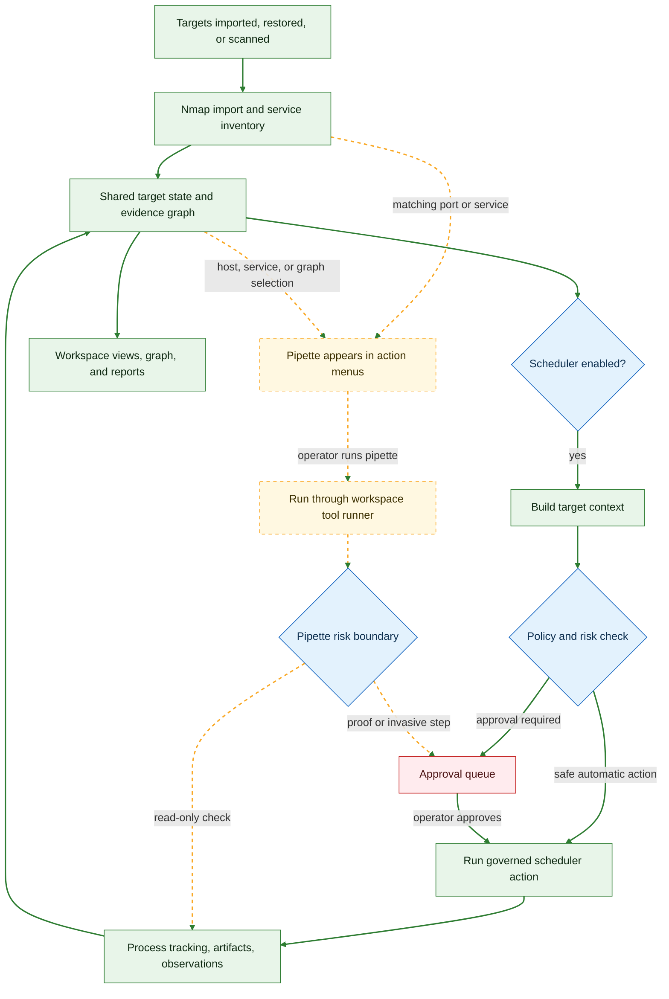

# Pipettes

Pipettes are bundled aggregate checks for a specific service family. Each one lives in its own folder under
`pipettes/` with a `manifest.json` and an entrypoint script. A pipette appears in the host, service, graph and manual
action menus when its manifest matches the selected target (by service name, protocol or port), and runs through the
same workspace tool runner as any other action, so its process, output and artifacts are tracked in the project.

Pipettes are **not** part of the automated scheduler path unless a pipette is explicitly promoted into a governed
scheduler action. Read-only checks run directly; anything that would prove or exploit an exposure goes through the
approval queue like any other risky action.

## Bundled pipettes

| Folder | Label | What it checks |
| --- | --- | --- |
| `cisco-smart-install` | Cisco Smart Install exposure check | Reachability and service detection on TCP/4786 plus the local `cisco-smi` NSE script. Read-only; SIET proof/exploit steps are deliberately not run. |
| `ipmi-oob/discovery` | IPMI, iDRAC, and iLO discovery | IPMI version and Cipher Zero checks, service/CPE discovery on common management ports, VNC console metadata, and Supermicro BMC disclosure indicators (no credential download). |
| `smtp/internal-discovery` | Internal SMTP discovery and relay check | Service detection and SMTP NSE scripts for command discovery, user enumeration behaviour, open relay and known Exim/Sendmail issues; SPF review only when a domain is supplied. |
| `windows-systems/discovery` | Windows systems discovery | SMB/RDP exposure, SMB signing posture, anonymous and null-session share visibility, RDP encryption and MS12-020 indicators, and conservative AD CS web-enrollment hints. |

## Where pipettes sit in the flow

Solid green edges are the automated scheduler path; dashed amber edges are the optional, operator-driven pipette path.

## Writing a pipette

1. Create a folder under `pipettes/` with a `manifest.json` and an executable entrypoint.
2. In the manifest, set `id`, `label`, `description`, `entrypoint`, and the `service_scope` / `protocol_scope` (and
   optionally port scope) that decide where the pipette is offered. Optional inputs (such as the SMTP pipette's
   `SPF domain`) are declared in the manifest and prompted for in the UI.
3. Keep the default run read-only. Anything that proves or exploits an exposure must be a separate, clearly labelled
   step so that it is routed through approval.
4. Write findings to stdout in the same shape as the bundled pipettes so the importer can attach them to the host.

Look at `pipettes/cisco-smart-install/` for the smallest complete example.
